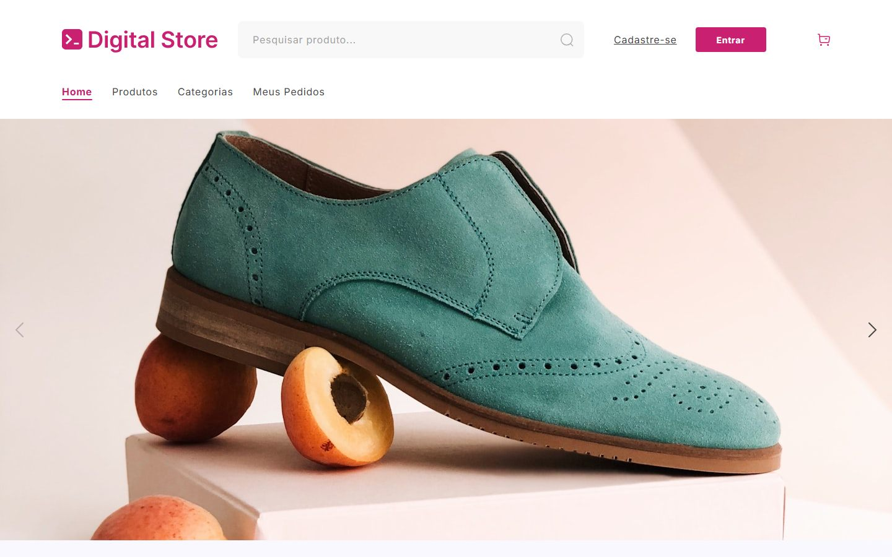
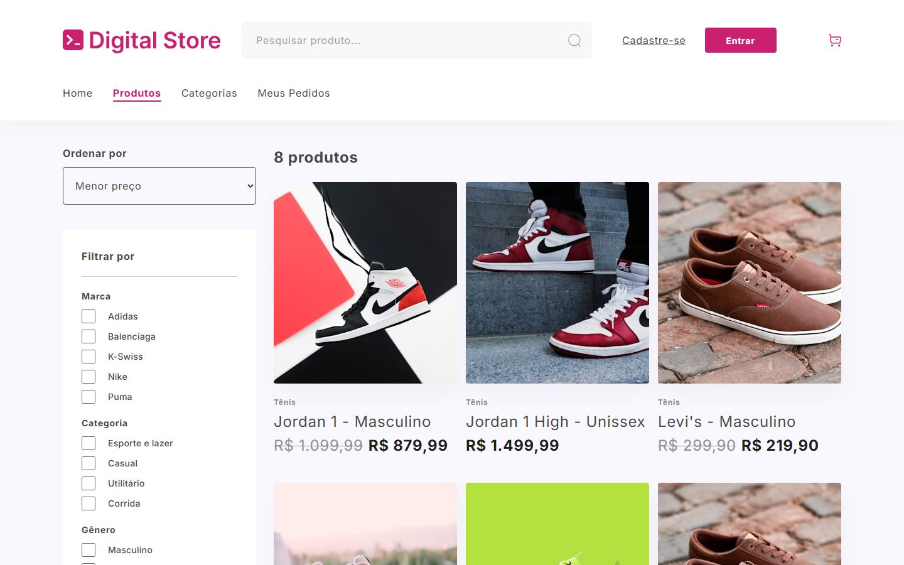
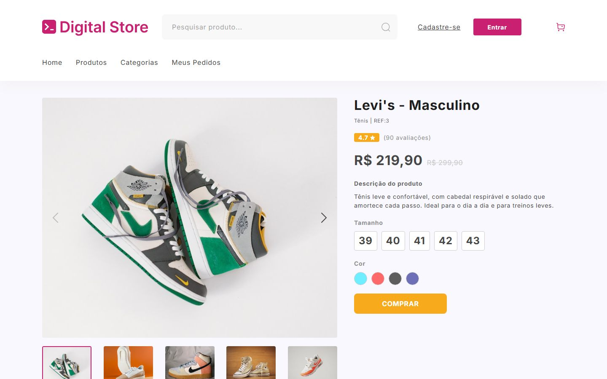

# Digital Store

Loja virtual em React feita no curso da Digital College (Sprint 1): página inicial, listagem de produtos e página do produto, a partir do design no Figma.

**Deploy:** https://digital-store-mauve-eta.vercel.app



| Listagem de produtos                               | Página do produto                             |
| -------------------------------------------------- | --------------------------------------------- |
|  |  |

## Tecnologias

- React 19 e React Router 7
- Vite 8
- CSS Modules
- Vitest e Testing Library
- oxlint e Prettier
- GitHub Actions (CI) e Vercel (deploy)

## Pré-requisitos

- Node.js 24 (versão definida no `.nvmrc`)

## Como rodar

```bash
git clone https://github.com/arthurvinicius-dev/projeto-digital-store.git
cd projeto-digital-store
npm install
npm run dev
```

Depois abra http://localhost:5173.

## Scripts

| Script            | O que faz                                                     |
| ----------------- | ------------------------------------------------------------- |
| `npm run dev`     | servidor de desenvolvimento                                   |
| `npm run build`   | gera a versão de produção em `dist/`                          |
| `npm run preview` | serve o `dist/` localmente                                    |
| `npm test`        | roda os testes                                                |
| `npm run lint`    | procura problemas no código com o oxlint                      |
| `npm run ci`      | lint, formatação, testes e build, como no GitHub Actions      |

## Estrutura

```
public/          imagens servidas na raiz do site
src/
  assets/        SVGs (logo e ícones)
  components/    componentes reutilizáveis (Header, Gallery, BuyBox...)
  data/          dados de exemplo (produtos, filtros, slides)
  pages/         páginas e o Layout
  styles/        tokens de design e CSS global
  utils/         funções auxiliares
doc/             enunciado do projeto e prints
```

## Enunciado

O enunciado original do projeto está em [doc/ENUNCIADO.md](./doc/ENUNCIADO.md).

## Autor

Arthur Vinicius: [github.com/arthurvinicius-dev](https://github.com/arthurvinicius-dev)
